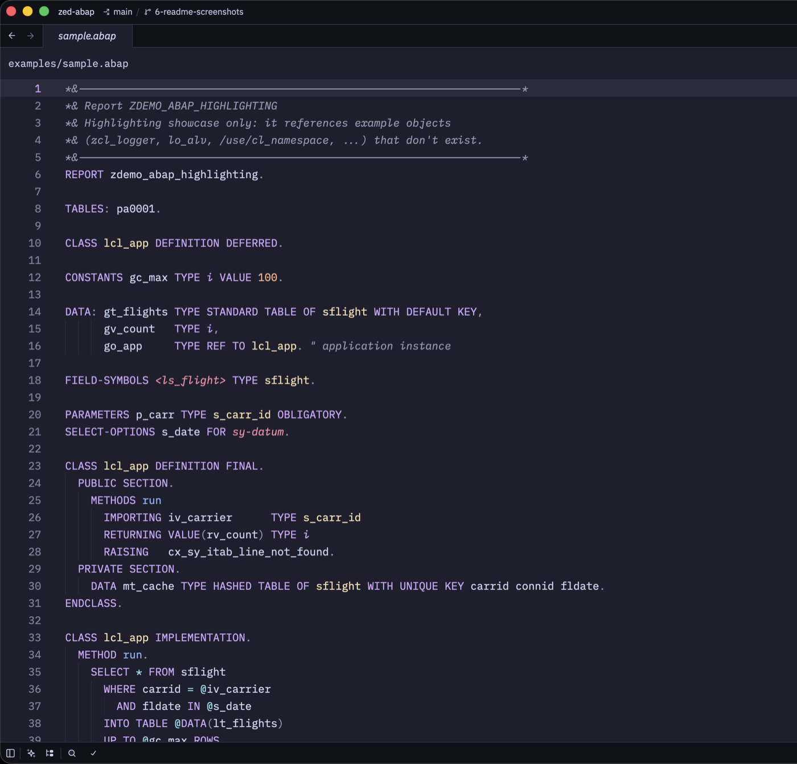
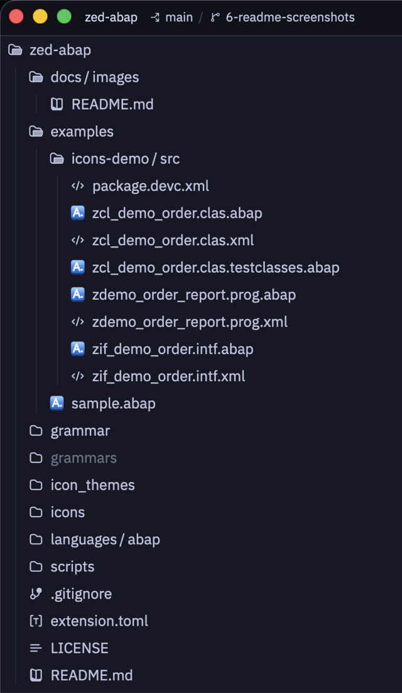
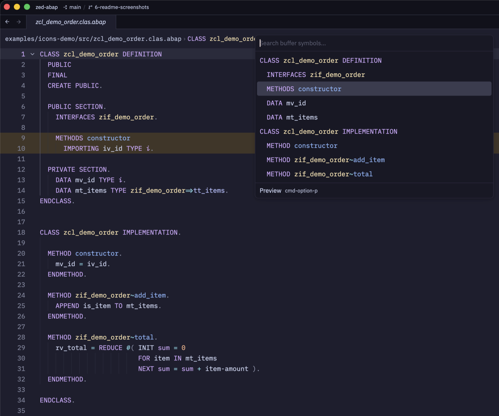

# zed-abap

ABAP language support for [Zed](https://zed.dev): syntax highlighting, a nested outline / symbol search, auto-indent, code folding, bracket matching, comment toggling, Vim text objects and an optional file icon theme.

<p align="center"></p>

> [!NOTE]
> **This project is "vibe coded".** The grammar, scanner, queries, scripts and docs were written by [Claude Code](https://claude.com/claude-code) (Anthropic's AI coding agent) from plain-language direction, not by hand.
> It was also **reviewed entirely by Claude**: multi-agent Claude code reviews of every change, with the findings fixed. Testing was a tree-sitter test corpus, real SAP standard code, a benchmark of Zed's highlighting path, and a port of Zed's auto-indent algorithm run against SAP's own formatting.
> Expect rough edges, and please open an issue if some ABAP doesn't parse or highlight correctly.

```
zed-abap/
├── extension.toml          # Zed extension manifest (points at grammar/ by commit SHA)
├── languages/abap/
│   ├── config.toml         # file types, comments, brackets
│   ├── highlights.scm      # highlighting
│   ├── outline.scm         # nested: CLASS > METHOD, CLASS DEFINITION > METHODS / DATA, FORM, ...
│   ├── indents.scm         # auto-indent from block structure
│   ├── textobjects.scm     # Vim: ]m / af / if (methods, forms), ]] / ac / ic (classes)
│   ├── injections.scm      # SQLScript in AMDP methods → SQL highlighting (if installed)
│   ├── brackets.scm
│   └── overrides.scm       # string/comment scopes for bracket auto-closing
├── icon_themes/abap.json   # "Zed (Default) + ABAP" icon theme
├── icons/abap.svg          # its icon
├── grammar/                # tree-sitter-abap
│   ├── grammar.js
│   ├── src/scanner.c       # column-0 `*` comments, `meth( ` call parens, AMDP bodies,
│   │                       # CATCH SYSTEM-EXCEPTIONS
│   └── test/corpus/
├── examples/
│   ├── sample.abap         # highlighting showcase (not meant to compile)
│   └── icons-demo/         # dummy abapGit package for the README screenshots
├── docs/images/            # README screenshots
└── scripts/bump-grammar.sh
```

## Install locally

1. In Zed, open the command palette and run **`zed: install dev extension`**.
2. Pick this folder.
3. Open `examples/sample.abap`.

Zed checks out the grammar at the `rev` in `extension.toml` and compiles it to WASM into `grammars/` (git-ignored). Check **`zed: open log`** if anything fails.

## File icons

The extension also ships an icon theme, **Zed (Default) + ABAP**. It is Zed's default icon theme plus an icon for ABAP files. Turn it on with **`icon theme selector: toggle`**, or in `settings.json`:

```json
"icon_theme": "Zed (Default) + ABAP"
```

If your `icon_theme` setting follows the system appearance (`{ "mode": "system", "light": …, "dark": … }`), the selector only fills the slot for the current mode, so set both `light` and `dark` to `"Zed (Default) + ABAP"`. The icon is drawn to read on light and dark backgrounds.

If the theme isn't listed, run **`zed: rebuild dev extension`**: Zed registers icon themes when it builds the extension, and the same applies after changing `icon_themes/` or `icons/`.

<p align="center"></p>

Every `.abap` file (in lower or UPPER case) gets a blue **A.** tile, `icons/abap.svg`. Zed shows one icon theme at a time, so choosing this one replaces any other icon theme you use. Every non-ABAP file keeps Zed's default icon: Zed merges its default file associations into extension icon themes and falls back to its default icons for anything the theme doesn't draw.

## Working on the grammar

All commands below run from the repo root.

```sh
(cd grammar && npm install)                                  # once
(cd grammar && npx tree-sitter generate && npx tree-sitter test)
(cd grammar && npx tree-sitter parse ../examples/sample.abap)
(cd grammar && npx tree-sitter query ../languages/abap/highlights.scm ../examples/sample.abap)
```

Zed builds the grammar from a **commit**, not your working tree. After changing `grammar.js` or `scanner.c`:

```sh
scripts/bump-grammar.sh "Describe the grammar change"
```

The script regenerates the parser, runs the corpus tests, and checks that every `languages/abap/*.scm` query still compiles. A broken query stops the whole language loading in Zed. It then commits **only** `grammar/`, updates `rev` in `extension.toml`, and commits only that file.

Zed fetches that commit from GitHub, so **`git push`** before running **`zed: rebuild dev extension`**.

Query (`.scm`), `config.toml`, icon theme and icon changes only need the rebuild, plus a normal commit.

## Grammar source: GitHub vs local path

`[grammars.abap].repository` points at `https://github.com/SharkmanZA/zed-abap`. The repo is private, so Zed's `git fetch` uses your normal git credentials (osxkeychain).

To iterate on the grammar without pushing, point it at this folder instead, e.g. `file:///Users/Work/Documents/Personal/Projects/zed-abap`. Don't commit that.

Whenever you change `repository`, **delete the existing clone first**:

```sh
rm -rf grammars/abap
```

Otherwise `zed: rebuild dev extension` fails with "grammar directory … already exists, but is not a git clone of …".

## Block structure

The grammar parses ABAP's statement blocks, which drive the nested outline, auto-indent and text objects:

<p align="center"></p>

<!-- Screenshot: uncomment once docs/images/auto-indent.gif exists (see docs/images/README.md).

-->

| Block | Clauses |
| --- | --- |
| `IF` … `ENDIF` | `ELSEIF`, `ELSE` |
| `CASE` … `ENDCASE` | `WHEN` |
| `TRY` … `ENDTRY` | `CATCH`, `CLEANUP` |
| `LOOP`, `DO`, `WHILE` | |
| `METHOD`, `FORM`, `FUNCTION`, `MODULE` | |
| `CLASS … DEFINITION` … `ENDCLASS` | `PUBLIC` / `PROTECTED` / `PRIVATE SECTION` |
| `CLASS … IMPLEMENTATION`, `INTERFACE` | |
| `CATCH SYSTEM-EXCEPTIONS` … `ENDCATCH` | |

AMDP methods (`METHOD m BY DATABASE PROCEDURE …`) are blocks whose body is kept as raw SQLScript (its statements end in `;`, not `.`).

- **Folding.** Zed folds by indentation, so blocks fold as long as they're indented, and auto-indent keeps new code indented.
- **Auto-indent.** Statements inside a block are indented one level (2 spaces). `ELSE`, `WHEN`, `CATCH`, `… SECTION` and every `END…` line up with the statement that opened them as you type them, including after empty clauses and after commented-out `*` lines. Pressing Enter after an opening statement (`IF x.`) or at the end of a clause body keeps you at the body's indentation. Event blocks (`START-OF-SELECTION.`, `AT SELECTION-SCREEN …`) indent their statements, and the next event, `FORM` or `CLASS` goes back to column 0. Measured against SAP's own formatting of standard code, the suggested indent matches on 91–100% of statement lines per file (excluding continuation lines of multi-line statements).
- **Not identical to the SAP pretty printer.** New `CATCH` lines line up with `TRY`, like `ELSE` with `IF`. The pretty printer indents a TRY body by 4 and `CATCH` by 2, which Zed can't express, because it indents one level relative to the previous line. `ENDTRY` still lines up with `TRY` in pretty-printed code. Continuation lines of multi-line statements keep the previous line's indent.
- **Not modelled as blocks:** `SELECT … ENDSELECT` (a SELECT loop can't be told from a single SELECT by its first line), `AT NEW … ENDAT`, `DEFINE … END-OF-DEFINITION` and similar. Their closing lines still outdent.

## Design notes

- **Mostly flat grammar.** A file is a list of statements, and each statement is a list of tokens ending in `.`. ABAP keywords aren't reserved and are case-insensitive, so most keyword colouring happens in `highlights.scm` with `(?i)` regexes. This keeps the parser tolerant of real code, including chained statements, macros and old syntax.
- **Small structures where highlighting needs them.** These are `member_access` (`a->b`, `c=>d`, `i~m`), `call` (`meth( `, with a blank after the paren, per ABAP rules), `access` (`lv(4)`, `DATA(x)`, `e001(zmsg)`), `type_spec` / `ref_type` / `table_type` (`TYPE x`, `REF TO x`, `TABLE OF x`) and `constructor_expression` (`NEW zcl( )`, `CONV string( )`). Without them, the queries would need sibling patterns that scan whole statements. Those were measured at ~10 ms per 50-row chunk inside a 5,000-line `DATA:` chain, and dropped highlights. With the structures it's ~0.1–0.25 ms.
- **Grammar keywords** (TYPE, REF, TO, TABLE, RANGE, OF and the constructor keywords) are recognised in lower, UPPER and Capitalised spelling. Tree-sitter keyword extraction only works with string literals. Other casings still parse, as plain names.
- **Grammar keywords are still plain names where only an identifier fits.** Method, attribute, call and access names can be anything: `lo->value`, `zcl=>new( )`, `METHOD zif~ref.`
- **Data objects after TYPE.** Some statements take a variable after TYPE (`MESSAGE lv TYPE lv_msgty`, `DESCRIBE FIELD lv TYPE lv_type`). Telling them apart would need a scan of the whole statement, so names following the usual convention (`lv_`, `ls_`, `lt_`, `lo_`, `gv_`, `mv_`, `iv_`, …, `sy-`) are coloured as variables there instead of types.
- **Highlight precedence.** In Zed, when several patterns capture the same node, the later pattern wins, so `highlights.scm` is ordered general → specific.
- **Hyphens bind to names.** ABAP requires spaces around `-` as an operator, so `ls_x-field`, `sy-subrc` and `END-OF-SELECTION` each lex as one `name`.
- **Blocks open only on a keyword at the start of a statement.** `IF`, `WHEN`, `METHOD`, … anywhere else are ordinary words: `CALL METHOD`, `COND #( WHEN … )`, `FOR … WHILE`, `lo->method( )`.
- **Blocks tolerate unbalanced code.** Closing statements are optional, so an IF you haven't closed yet doesn't turn the rest of the file into a parse error. Any `END…` closes, and any clause keyword (`ELSE`, `WHEN`, `CATCH`, …) continues, the innermost open block. In valid ABAP that is always the matching one. Accepting them in every block also keeps parser generation under ~2 s, where tracking which block accepts which keyword grew combinatorially with the number of block types. The side effect only shows while typing unbalanced code: an `ENDMETHOD` below an unclosed `IF` closes the `IF` until you add the `ENDIF`. An `END…` with no open block at all is an ordinary statement.
- **Block keywords are still usable as names.** `method = 'GET'.`, `form->run( ).`, `do( ).` and `DATA method TYPE string.` are ordinary statements about variables or methods with those names.
- **Comment toggling uses `"` only.** `*` comments must start in column 0, but Zed matches comment prefixes after indentation, so `* factor` continuation lines would be treated as comments.

## Ideas / next steps

- Model `SELECT … ENDSELECT`, `AT NEW … ENDAT` and event blocks in the grammar too.
- abaplint language server for diagnostics.

## License

MIT, see [LICENSE](LICENSE).
